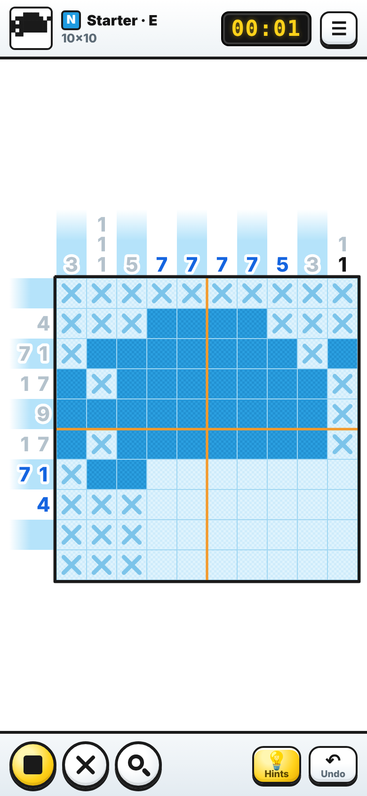
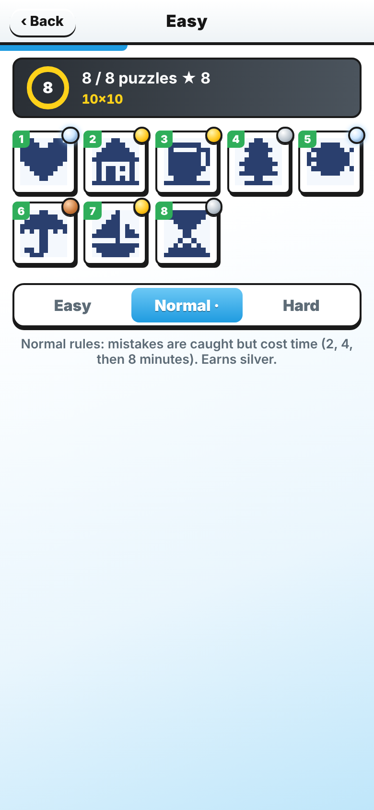

<p align="center"></p>

<h1 align="center">MomoGram</h1>

<p align="center"><b>One nonogram player for all the nonogram games you own</b>, on every screen: your phone (in portrait!),
the browser, Windows, macOS, Linux, Steam Deck and Android.<br>
Add your games once: MomoGram turns each into a pack with its levels, puzzle names, pictures, music and colours.</p>

<p align="center">
<a href="https://emil007.github.io/MomoGram/"><b>▶ Play in the browser</b></a> ·
<a href="https://github.com/Emil007/MomoGram/releases/latest"><b>⬇ Downloads</b></a> ·
<a href="#supported-games">Supported games</a> ·
<a href="#platforms">Platforms</a>
</p>

<p align="center">
<a href="https://github.com/Emil007/MomoGram/releases/latest"></a>
<a href="https://github.com/Emil007/MomoGram/actions/workflows/release.yml"></a>


</p>

| Your phone, upright | Pick a puzzle, earn medals | Solved |
|---|---|---|
|  |  |  |

<p align="center"><br>
<em>Desktop / Steam Deck: keyboard, mouse and gamepad. Screenshots show MomoGram's own starter puzzles.</em></p>

> **No game data is included.** Start with MomoGram's own starter puzzles, then add the games you own
> (**Add games** on the home screen): MomoGram reads puzzles, names, pictures and music from your files.
> Everything stays on your device.

> **Disclaimer: 100% AI.** MomoGram (the game, the ROM readers, the importers, the sound code, the builds and
> this documentation) was written entirely by an AI (Claude, by Anthropic), directed and tested by a human.
> No line of code was written by hand. Expect AI-typical mistakes, and please report what you find.

The name: *nonogram* + **Momo**, from Michael Ende's novel about the grey men who steal people's time.
Nonograms do that too.

## What you get

- **Your games in one library:** every game you add becomes a card on the home screen, with its own modes and levels, puzzle names, solved pictures, music and colours, and its own progress.
- **A daily nonogram:** five small puzzles a day, picked from all the games in your library.
- **A board that feels like the handheld:** striped clue bands, dithered cells, orange guides every five cells, a cursor that lights up its row and column into the clues, a drag counter, and clue numbers that grey out only when their block is certainly in place.
- **Made for one hand on a phone:** portrait layout, the tools at the bottom within thumb reach, pinch to zoom, drags that stay on their row or column.
- **Every level on every difficulty**, with medals:

  | | Mistakes | Hint roulette | Medal |
  |---|---|---|---|
  | **Easy** | caught, no time penalty | offered | 🥉 Bronze |
  | **Normal** | caught, +2 / 4 / 8 minutes | offered | 🥈 Silver |
  | **Hard** | not checked, *Try it out* to test ideas | none | 🥇 Gold, 💠 **Platinum** without logic hints |

- **Logic hints** (💡): clue numbers turn blue when their line lets you deduce a new cell, like the newer 3DS and Switch games.
- **The hint roulette**, spinning over rows and columns like the original.
- **Random music** from the game you're playing, or from all your games.
- **Eight starter puzzles** by MomoGram itself, so you can try it before you add a game.
- **Profiles** with their own saves; export a save and import it on another device (only newer games are taken over).
- Quick save, best times, offline play after the first start, English and German UI.

## Supported games

**Add games** (home screen) or **Puzzle packs → Create packs from your games**: choose game files you own (raw, or in `.zip` / `.7z` / `.rar`).
MomoGram finds the puzzles and makes one pack per game, with the original level structure and the puzzle
names where the game has them. Regional versions of the same game become **one** pack with every
language's names. Do it once, keep the files, import them anywhere.

| Game | Platform | Puzzles | Music & colours |
|---|---|---|---|
| Picross DS (full game and the Download Station / Nintendo Channel demos) | DS | ✓ all modes and levels, solved-picture animations, daily puzzles | ✓ the game's own (title, nine in-game styles, clear jingle) |
| Picross e, e2–e9, Pokémon Picross, Club Nintendo Picross (+ Plus), My Nintendo Picross, Sanrio Characters Picross | 3DS (decrypted) | ✓ | ✓ the game's music, colours from its icon |
| Mario's Picross | Game Boy | ✓ Easy, Kinoko, Star, Time Trial | ✓ the game's music (emulated), Super Game Boy colours |
| Picross 2 | Game Boy | ✓ as 15×15 sections | ✓ the game's music (emulated), Super Game Boy colours |
| Pokémon Picross (prototype) | Game Boy Color | ✓ all 217 stages (main game incl. Mew, Safari Zone); 20×20 and 30×30 pictures as their four sections | ✓ the game's music (emulated); colours in progress |
| Mario no Super Picross (also the Virtual Console release) | Super Famicom | ✓ all 300 puzzles | ✓ the game's music (emulated) |
| Tamori no Picross | Satellaview (.bs) | ✓ standard, daily and weekly puzzles; broadcasts are merged into one pack | ✓ the game's music (emulated) |
| Picross NP Vol. 1–8 | Super Famicom (Nintendo Power) | ✓ all puzzles of each volume, in sets of twelve (tested with Vol. 1: 120 puzzles) | ✓ the game's own music (emulated) |
| Picross S series | Switch | later | later |

Only puzzles from Jupiter / Nintendo releases are supported. To add a game, see [docs/writing-importers.md](docs/writing-importers.md); each file in `src/packs/importers/` lists the games it reads and where their data is.

### Sound emulation (Game Boy, Super Famicom, Satellaview)

The Game Boy and Super Famicom games have no recorded music, only a sound program, so MomoGram runs that
program on emulated hardware, in an AudioWorklet (`worklet.js`, off the main thread; a ScriptProcessor fallback
for old browsers). Everything is MomoGram's own code, written from the public hardware documentation (Pan Docs /
gbdev.io for the Game Boy, fullsnes and anomie's documents for the SPC700, S-DSP and 65C816). No boot ROMs and
no game data are included.

- **Game Boy / Game Boy Color** (`src/audio/gb/`): Sharp LR35902 CPU with MBC1/3/5 banking, timer, interrupts
  and LCD timing; the APU with both pulse channels (sweep), wave, noise, frame sequencer and the output
  high-pass filter. Jupiter's games use Toshiyuki Ueno's "DSEQ" sound driver; MomoGram finds its two wrapper
  routines by byte pattern and calls them like a GBS player (start song, then the update routine at 59.7 Hz).
  A pack keeps only bank 0 and the driver banks of your ROM (32–48 KB).
- **Super Famicom / Satellaview** (`src/audio/snes/`): SPC700 with timers and I/O, the S-DSP (BRR decoding,
  4-point interpolation, ADSR / GAIN, noise, pitch modulation, 8-tap FIR echo, 32 kHz) and, for pack creation
  only, a 65C816 with the parts of the console a game touches while starting. The boot-ROM upload protocol is
  emulated instead of included. When you create a pack, your ROM boots until the game has loaded its sound
  driver, then the game's own play-song routine is called for each song MomoGram uses, and a compressed snapshot
  of the sound system (about 150–230 KB) is stored with the pack. Playback runs the SPC700 / S-DSP from there.

| Game | Songs found | Used for |
|---|---|---|
| Mario's Picross | 19 (1–$13) | title, menu, two puzzle tracks, clear jingle |
| Picross 2 | 28 (1–$1C) | title, menu, two puzzle tracks, clear jingle |
| Pokémon Picross (prototype) | 36 ($01–$19, $81–$8B) | title, menu, puzzle, clear jingle |
| Mario no Super Picross | 24 ($00–$19, bit 6 = looping) | title, menu, puzzle, clear jingle |
| Picross NP Vol. 1–8 | same engine | title, menu, two puzzle tracks, clear jingle |
| Tamori no Picross | same engine | title, menu, two puzzle tracks, clear jingle |

Which song plays where was found by tracing the songs each game requests on its own screens (and its puzzle
music table); clear jingles were picked by their length where the game could not be traced to that screen.
Audio was checked numerically only (level, silence, loop and end detection). Packs made before version 0.5.0
have no Game Boy / Super Famicom music: create them again. Known gaps: the combined Satellaview dump
"Tamori no Picross (8-13) + Bakushow …" has its sound library in an unexpected place and gets no music; the
S-DSP is sample-accurate rather than cycle-accurate and its interpolation kernel is computed, not the console's
table, so it sounds very close but not bit-identical.

**Exports:** a pack is one small `.momopack.json`. Packs with music are exported as a `.zip` with the
music in a folder next to the pack. That music comes from your game: keep those packs for your own
devices and don't share them. Options → *Original music / colours of packs* switch both off.

<details>
<summary><b>Pack format</b></summary>

```jsonc
{
  "format": "momogram-pack", "version": 1,
  "id": "gb-marios-picross",
  "title": { "en": "Mario's Picross" },
  "source": { "game": "Mario's Picross", "platform": "Game Boy" },
  "theme": { "palette": { "accent": "#4d533c", "style": "dmg" }, "music": { "menu": "…", "play": "…" } },
  "levels": [{
    "id": "easy-a", "title": { "en": "Easy A" }, "rules": "normal", "group": "easy",
    "puzzles": [{ "id": "easy-a-01", "width": 5, "height": 5,
                  "rows": ["..#..", ".###.", "#####", ".###.", "..#.."],
                  "name": { "en": "…" } }]
  }]
}
```

`rows` uses `#` for filled and `.` for empty. Levels can have `unlockAfter` (cleared puzzles in the same
`group`) and `extra`. `theme.music` names files in `<pack>.assets/` next to the pack.
</details>

## Platforms

Every push that changes the version builds a release on GitHub, for all of these:

| Platform | Download | Notes |
|---|---|---|
| **Browser** | [emil007.github.io/MomoGram](https://emil007.github.io/MomoGram/) | Chrome, Edge, Firefox, Safari. Install it as an app (*Add to Home Screen*), works offline. |
| **Android** | `MomoGram-<version>-Android.apk` | Allow installing from your browser / file manager, then open the APK. |
| **iPhone / iPad** | the browser version | Share → *Add to Home Screen* gives a full-screen app. |
| **Windows** | `MomoGram-<version>-Windows-x64-Setup.exe` or the `.zip` (x64 / arm64) | Unsigned: on the SmartScreen warning choose *More info → Run anyway*. |
| **macOS** | `MomoGram-<version>-macOS-arm64.dmg` (Apple Silicon) or `-x64.dmg` (Intel) | Not notarized: the first time, right-click the app → **Open**, or run `xattr -cr /Applications/MomoGram.app`. |
| **Linux** | `MomoGram-<version>-Linux-x86_64.AppImage` or `.tar.gz` (x64 / arm64) | `chmod +x` the AppImage. ARM64 runs on Raspberry Pi and ARM handhelds. |
| **Steam Deck** | the Linux AppImage | Add it to Steam as a non-Steam game; it starts fullscreen in Gaming Mode. |
| **RecompLauncher** | every release carries a `recomplauncher.json` | [RecompLauncher](https://github.com/elripalda/RecompLauncher) installs, updates and starts MomoGram. |

The desktop app takes `--rom <file.nds>` (or a ROM dropped on the program) to load a ROM at start, and
`--fullscreen`.

## Pack files

A pack is a single `.momopack` file: a zip with `pack.json` (the puzzles, plus a hidden version) and `assets/` (music, pictures, the game's icon). Double-clicking one opens it in the desktop app, or in the installed web version where the browser supports it. Older `.momopack.json` files and `.zip` exports still work. The format is described in [docs/momopack-format.md](docs/momopack-format.md).

## Your own server

If you want to, you can run a small server on your own web space (PHP with MySQL, e.g. Plesk). It keeps progress, the paused puzzle and settings in sync between your devices. It also keeps packs for everyone with an account there and shows high scores (puzzles solved, medals, fastest times). Accounts need an invite code that you choose. Download `MomoGram-…-server.zip` from the releases and follow [server/README.md](server/README.md).

## Controls

| | Touch / mouse | Keyboard | Gamepad / Steam Deck |
|---|---|---|---|
| Fill | tap / drag (stays on its row or column) | `Z` / Space, hold and move to paint | A |
| Cross out | ✕ tool, or right click | `X` | B |
| Move | | arrows / WASD | D-pad |
| Zoom | pinch, wheel, 🔍 | `C` | Y |
| Undo | ↶ | `U`, Ctrl+Z | L |
| Try it out (Hard) | ✎ | | R |
| Menu | ☰ | Esc | Start |

## Building

```sh
npm ci
npm run build                 # web app in dist/web: static files for any web host
cp -r dist/web electron/web
cd electron && npm install && npx electron-builder --publish never   # desktop builds in dist/desktop
```

The GitHub Actions in `.github/workflows` do the rest: `ci.yml` (typecheck and build), `pages.yml`
(web version on GitHub Pages) and `release.yml` (web, Windows, macOS, Linux x64/arm64 and the Android
APK via Capacitor, released when `version` in `package.json` changes).

<details>
<summary><b>How it works</b></summary>

- `src/rom/nds.ts`: DS ROM file system, ARM9 / overlays, BLZ decompression.
- `src/rom/picrossds.ts`: puzzle-set tables, records, display order, localized names and solved-picture animation scripts.
- `src/rom/dsgfx.ts`: DS OBJ cells (4bpp, 2D mapping) for the solved pictures.
- `src/rom/ctr.ts`: decrypted 3DS containers (NCSD / NCCH / CIA), RomFS, icon, LZ11.
- `src/audio/`: SDAT reader and SSEQ sequencer (DS music), BCSTM DSP-ADPCM decoder (3DS music); `gb/` and `snes/`: sound hardware emulation (see *Sound emulation*), `worklet.ts` / `chipplayer.ts`: playback on the audio thread.
- `src/packs/`: pack format, importers per platform, pack colours.
- `src/game/`: rules, exact line analysis (clue greying and logic hints), the board renderer.
- `src/app.ts`, `src/ui/`: screens.
</details>

## License

MIT for MomoGram's own code and its starter puzzles. Picross is a trademark of Nintendo; the game titles
named in the table of supported games are trademarks of their owners (Nintendo, Jupiter). MomoGram is an
unofficial fan project, not affiliated with or endorsed by them.
