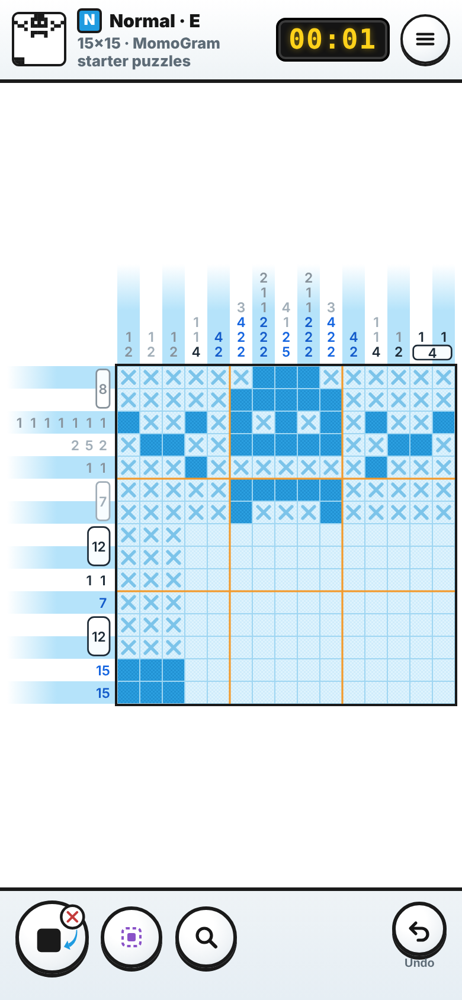
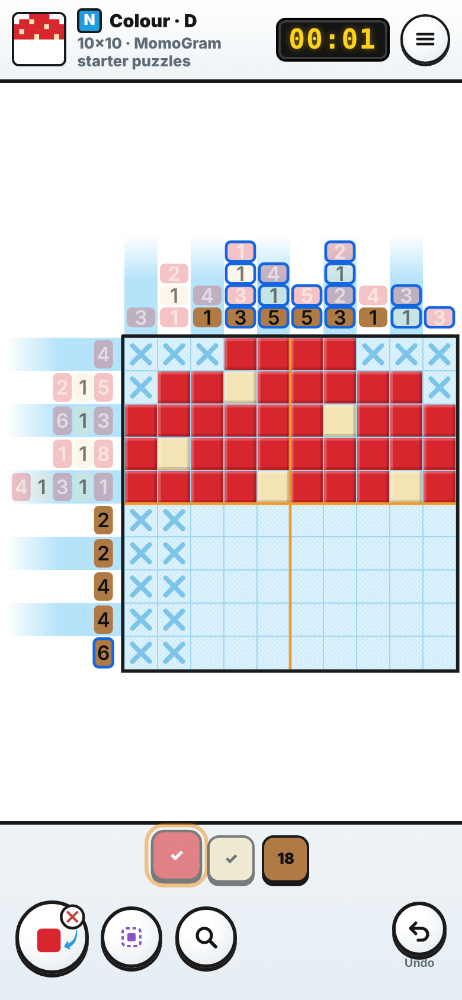

<p align="center"></p>

<h1 align="center">MomoGram</h1>

<p align="center"><b>One nonogram player for all the nonogram games you own</b>, on every screen: your phone (in portrait!),
the browser, Windows, macOS, Linux, Steam Deck and Android.<br>
Add your games once: MomoGram turns each into a pack with its levels, puzzle names, pictures, music and colors.</p>

<p align="center">
<a href="https://emil007.github.io/MomoGram/"><b>▶ Play in the browser</b></a> ·
<a href="https://github.com/Emil007/MomoGram/releases/latest"><b>⬇ Downloads</b></a> ·
<a href="#supported-games">Supported games</a> ·
<a href="#platforms">Platforms</a>
</p>

<p align="center">
<a href="https://github.com/Emil007/MomoGram/releases/latest"></a>
<a href="https://github.com/Emil007/MomoGram/actions/workflows/release.yml"></a>


</p>

| Your library | Pick a puzzle | Play, one-handed |
|---|---|---|
|  |  |  |
| **Mega mode** | **Color mode** | **Solved** |
|  |  |  |

<p align="center"><br>
<em>Desktop / Steam Deck in dark mode, playing Mega: keyboard, mouse and gamepad. The screenshots show MomoGram's own starter puzzles.</em></p>

> **No game data is included.** Start with MomoGram's own starter puzzles, then add the games you own:
> MomoGram reads the puzzles, names, pictures and music from your files. Everything stays on your device
> (or on your own server, if you set one up).

> **Disclaimer: 100% AI.** MomoGram (the game, the ROM readers, the importers, the sound code, the server,
> the builds and this documentation) was written entirely by an AI (Claude, by Anthropic), directed and tested
> by a human. No line of code was written by hand. Expect AI-typical mistakes, and please report what you find.

The name: *nonogram* + **Momo**, from Michael Ende's novel about the grey men who steal people's time.
Nonograms do that too.

## What you get

- **All your nonogram games in one library**, each with its own modes and levels, the puzzle names, solved pictures, music and colors of the original. Series form folders (all Picross e games, the S series, Picross NP, Illust Logic …); show them as cards, tiles or a list, sorted by series or system.
- **Every puzzle on every rules set**, with a medal as flair (points are what count):

  | | Mistakes | Hint roulette | Medal |
  |---|---|---|---|
  | **Bronze** | caught, no time penalty | offered | 🥉 Bronze |
  | **Silver** | caught, +2 / 4 / 8 minutes | offered | 🥈 Silver |
  | **Gold** | not checked, *Try it out* to test ideas | none | 🥇 Gold, 💠 **Platinum** without logic hints |

- **Three ways to play:** the mode switch on the home screen cycles through *MomoGram*, *Mega MomoGram* and *Color MomoGram*. Each mode has its own progress, points, PixELO and high scores.
- **Mega mode** for everything: Mega numbers span two rows or columns. Games that have Mega puzzles bring their own (a glowing dot marks them); for all others MomoGram chooses the pairs, checks that each puzzle still has one solution, and makes the same choice on every device. Mega has its own progress and scores.
- **Color mode:** color nonograms, where every block has a color and blocks of different colors may touch. The games' own color puzzles (see below), MomoGram's own color starter puzzles, and color versions of the games' color pictures where they work (few, clearly different colors and exactly one solution, checked by MomoGram's color solver). A palette with the tools shows how many cells of each color are still missing.
- **Points and PixELO** – **points** are the score that ranks players; medals are a badge. PixELO is a chess-style rating of how good you are ([how they work](#points-and-pixelo)). Your PixELO is shown under your name.
- **A board that feels like the handhelds:** the row and column you draw in light up into the clues, a counter shows the length of the block you're drawing, clue numbers grey out only when their block is certainly done, logic hints (💡) turn a clue blue when its line gives away a new cell, and your own marks stay while you fill and cross the rest.
- **Made for one hand on a phone:** portrait layout, tools at the bottom (or right), stepless pinch zoom, drags that stay on their line. Keyboard, mouse and gamepad on the desktop and Steam Deck.
- **A daily nonogram** (**20** a day: 5 each in 5×5, 10×10, 15×15 and Big, from all your games). Clearing one counts on the **original game** (points and PixELO once); the daily list links to that progress. **Random** uses the same four sizes.
- **The games' own music**, every song of every game, with a sound test to choose where each plays.
- **Practice:** little games with random puzzles from your own games, in the mode that is on (Normal, Mega or Color), which don't count as solved: *Find the mistakes* (a finished picture with a few wrong cells), *Finish it* (most of a puzzle already solved), *5×5 sprint* (as many small puzzles as you can in a minute), *The next step* (a puzzle halfway through: find a cell that is certain now), *One line* (find every cell one marked line decides) and *Memory* (see the picture for 3 seconds, then solve it). Your best result in each is kept.
- **Interactive tutorials** for nonograms, Mega and Color (each offered once, all in the options), plus **technique lessons** for each (overlap from both ends, edges, joining, gaps, what-if, Mega shapes, color rules), one technique per step, an **editor** for your own puzzles, light and **dark mode**, and six languages (English, German, French, Spanish, Italian, Japanese) – the puzzle names come in every language the games have. [Adding a language](#translations) is one file.
- **Your progress is never lost:** paused puzzles, best times per difficulty, medals, profiles with their own saves.
- **Your own server (optional):** progress and settings on all your devices, packs shared within your family or friends, and high scores for up to 10 players.

## Supported games

**Options → Puzzle packs → Add games or packs** reads game files you own (raw, or in `.zip` / `.7z` / `.rar`; Android games as `.apk`, `.xapk`, `.apkm` or `.apks`), or a whole folder with everything in it — pointing at your full dump folder and letting it scan is the usual workflow. MomoGram makes one pack per game, with the original level structure; regional versions of a game become **one** pack with every language's names, and the same song in several games is stored only once. Do it once: export the packs, or keep them on your own server, and use them on every device.

One importer reads each group of games below (click a system to open it). Every number is what the games themselves contain (all regions together where there are several):

<details>
<summary><b>Nintendo DS, DSi and DSiWare</b> · 6,171 nonograms, 3,356 color nonograms</summary>

| Games | System | Nonograms | Mega nonograms | Color nonograms | Songs |
|---|---|---:|---:|---:|---:|
| Picross DS and its demos (Download Station, Nintendo Channel) | DS | 366 | – | – | 27 |
| Hudson's Illust Logic: Puzzle Series Vol. 6, Illust Logic DS + Colorful Logic, Illust Logic and + Nihon no Mukashi Banashi (DSiWare) | DS, DSiWare | 1,000 | – | 100 | 80 |
| DS Puzzler / Challenge Me: Brain Puzzles, DS Puzzler Wi-Fi Taiou | DS | 1,000 | – | – | 7 |
| SIMPLE DS Vol. 7 / Vol. 28: THE Illust Puzzle | DS | 2,801 | – | 2,800 | 17 |
| Illu-Logi VOW | DS | 139 | – | 166 | 40 |
| Puzzle Mate DS: Oekaki Mate | DS | 443 | – | 8 | 4 |
| Hello Kitty no Paku Paku & Logic | DS | 122 | – | – | 4 |
| Puzzle Iro Iro: Gekkan Crossword House Vol. 1 – 6 | DSiWare | 18 | – | – | 36 |
| Oekaki Puzzle Battle! Yuusha Ou GaoGaiGar Hen | DS | 282 | – | 282 | 7 |

</details>

<details>
<summary><b>Nintendo 3DS</b> · 2,062 nonograms, 1,956 Mega nonograms</summary>

| Games | System | Nonograms | Mega nonograms | Color nonograms | Songs |
|---|---|---:|---:|---:|---:|
| Picross e – e9, Pokémon Picross, Club Nintendo Picross (+ Plus), My Nintendo Picross: Zelda TP, Sanrio Characters Picross | 3DS (decrypted) | 2,062 | 1,956 | – | 88 |

</details>

<details>
<summary><b>Nintendo Switch</b> · 5,541 nonograms, 2,518 Mega nonograms, 733 color nonograms</summary>

| Games | System | Nonograms | Mega nonograms | Color nonograms | Songs |
|---|---|---:|---:|---:|---:|
| PICROSS S – S9, S+, S GENESIS, S Doraemon, S CAPCOM, S SNK, S NAMCO, Shield Hero, Kemono Friends, Lord of the Nazarick, LogiartGrimoire, Raden's Guide | Switch (decrypted RomFS folder or zip) | 3,182 | 2,518 | 433 | 325 |
| Squeakross: Home Squeak Home | Switch (decrypted RomFS folder or zip) | 650 | – | – | 43 |
| Eiga Sumikkogurashi: Asobo Characross | Switch (decrypted RomFS folder or zip) | 133 | – | – | 11 |
| Piczle Cross Adventure | Switch, Steam | 634 | – | – | 19 |
| Piczle Cross: Story of Seasons | Switch | 342 | – | – | – |
| Piczle Cross: Rune Factory | Switch | 600 | – | 300 | – |

</details>

<details>
<summary><b>Game Boy, Game Boy Color and Game Boy Advance</b> · 1,946 nonograms, 352 color nonograms</summary>

| Games | System | Nonograms | Mega nonograms | Color nonograms | Songs |
|---|---|---:|---:|---:|---:|
| Mario's Picross, Picross 2 | Game Boy | 1,104 | – | – | 47 |
| Pokémon Picross (unreleased prototype) | Game Boy Color | 490 | – | – | 36 |
| Hatena Satena | Game Boy Advance | 352 | – | 352 | – |

</details>

<details>
<summary><b>Super Famicom</b> · 2,317 nonograms</summary>

| Games | System | Nonograms | Mega nonograms | Color nonograms | Songs |
|---|---|---:|---:|---:|---:|
| Mario's Super Picross, Tamori no Picross | Super Famicom, Satellaview | 397 | – | – | 41 |
| Picross NP Vol. 1 – 8 | Super Famicom (Nintendo Power) | 1,320 | – | – | 168 |
| Oekaki Logic 1, 2 | Super Famicom (Nintendo Power) | 300 | – | – | – |
| Oh-chan no Oekaki Logic | Super Famicom | 300 | – | – | – |

</details>

<details>
<summary><b>Android</b> · 84,138 nonograms, 16,794 color nonograms, 15 songs</summary>

| Games | System | Nonograms | Mega nonograms | Color nonograms | Songs |
|---|---|---:|---:|---:|---:|
| Nonogram Crossing Logic | Android (.apk, .xapk, .apkm) | 22,679 | – | – | – |
| Nonogram - Jigsaw Puzzle Game | Android (.apk, .xapk, .apkm) | 11,808 | – | – | 2 |
| kungfu nonogram | Android (.apk, .xapk, .apkm) | 13,932 | – | – | 5 |
| Nonogram.com | Android (.apk, .xapk, .apkm) | 8,893 | – | 7,810 | – |
| Gem Nonogram | Android (.apk, .xapk, .apkm) | 8,640 | – | – | 3 |
| No2g: Nonogram | Android (.apk, .xapk, .apkm) | 8,399 | – | – | – |
| Nonogram Color | Android (.apk, .xapk, .apkm) | – | – | 7,424 | – |
| Nonogram King | Android (.apk, .xapk, .apkm) | 4,162 | – | – | 3 |
| Eyes Nonogram | Android (.apk, .xapk, .apkm) | 1,683 | – | – | 2 |
| Somnus : Nonogram | Android (.apk, .xapk, .apkm) | 1,068 | – | – | – |
| Nonograms (Classic) | Android (.apk, .xapk, .apkm) | 837 | – | 1,560 | – |
| Sky Castle (nonogram) | Android (.apk, .xapk, .apkm) | 797 | – | – | – |
| Nonogram (Kimbuja) | Android (.apk, .xapk, .apkm) | 476 | – | – | – |
| NetWitch | Android (.apk, .xapk, .apkm) | 379 | – | – | – |
| Cat Sitter (+ nonogram) | Android (.apk, .xapk, .apkm) | 312 | – | – | – |
| Nonogram Classic Games | Android (.apk, .xapk, .apkm) | 73 | – | – | – |

</details>

<details>
<summary><b>Misc: Steam and Arduboy</b> · 1,054 nonograms, 288 color nonograms</summary>

| Games | System | Nonograms | Mega nonograms | Color nonograms | Songs |
|---|---|---:|---:|---:|---:|
| PiCross, Picross a (homebrew) | Arduboy (.hex) | 325 | – | – | – |
| Charm Studies | Steam (the game folder) | 169 | – | – | 7 |
| SherloCAT Holmes Nonogram | Steam (the game folder) | 114 | – | – | 6 |
| Paint it Back | Steam (the game folder) | 158 | – | – | – |
| Pixel Puzzle Makeout League | Steam (the game folder) | 288 | – | 288 | 6 |

</details>

| | Nonograms | Mega nonograms | Color nonograms | Songs |
|---|---:|---:|---:|---:|
| **Total** | **103,229** | **4,474** | **21,523** | **1,034** |

MomoGram adds more on top: every nonogram can also be played as a Mega nonogram (with Mega numbers MomoGram places), and a game's pictures with a few colors become Color nonograms where they have exactly one solution (95 of Hudson's in Illust Logic DS, for example). Still to come: Animal Color Cross (DSiWare).

To add another game, see [docs/writing-importers.md](docs/writing-importers.md); each file in `src/packs/importers/` lists the games it reads and where their data is.

### Music

Every song a game has is stored with its pack and listed in the sound test (Options), where you choose which songs play on the title, in the menus, while solving and on the clear screen, or switch songs off. How the music is played:

| Platform | Source | How MomoGram plays it |
|---|---|---|
| DS / DSiWare | the game's SDAT sound archive | MomoGram's own SSEQ sequencer with the game's instruments |
| 3DS | BCSTM streams | DSP-ADPCM decoded in the browser |
| Switch | FMOD sound banks (FSB5) | the Vorbis streams rebuilt as Ogg files |
| Steam | Ogg files, or an FSB5 bank rebuilt as Ogg (a PCM16 sting stays a WAV) | the browser |
| Android | MP3 or Ogg in the package (Cocos / Unity / plain assets) | the browser |
| Game Boy / Game Boy Color | the game's sound program | emulated sound hardware (CPU and APU), only the sound banks are kept |
| Super Famicom / Satellaview | the game's sound program | emulated SPC700 and S-DSP, from a snapshot taken when the pack is made |

The Game Boy and Super Famicom games have no recorded music, only a sound program, so MomoGram runs that program on emulated hardware, in an AudioWorklet off the main thread. Everything is MomoGram's own code, written from the public hardware documentation (Pan Docs / gbdev.io, fullsnes and anomie's documents); no boot ROMs and no game data are included.

<details>
<summary>Details of the sound emulation</summary>

- **Game Boy / Game Boy Color** (`src/audio/gb/`): Sharp LR35902 CPU with MBC1/3/5 banking, timer, interrupts and LCD timing; the APU with both pulse channels (sweep), wave, noise, frame sequencer and the output high-pass filter. Jupiter's games use Toshiyuki Ueno's "DSEQ" sound driver; MomoGram finds its wrapper routines by byte pattern and calls them like a GBS player. A pack keeps only bank 0 and the driver banks of your ROM (32–48 KB).
- **Super Famicom / Satellaview** (`src/audio/snes/`): SPC700 with timers and I/O, the S-DSP (BRR decoding, 4-point interpolation, ADSR / GAIN, noise, pitch modulation, 8-tap FIR echo, 32 kHz) and, for pack creation only, a 65C816 with the parts of the console a game touches while starting. When you create a pack, your ROM boots until the game has loaded its sound driver, then the game's own play-song routine is called for every song, and a compressed snapshot of the sound system (about 1 MB) is stored with the pack.
- Which song plays where was found by tracing the songs each game requests on its own screens. The S-DSP is sample-accurate rather than cycle-accurate, so it sounds very close but not bit-identical.
</details>

### Why puzzles can be recognised by their picture

MomoGram matches puzzles by their pattern: to merge the regional versions of a game, to give a daily puzzle the
same id on every device, and to count a daily solve in its game. That is safe, because two different pictures
practically never have the same pattern:

| Grid | Possible patterns | About |
|---|---|---|
| 5 × 5 | 2<sup>25</sup> | 33,554,432 (33.6 million) |
| 10 × 10 | 2<sup>100</sup> | 1.27 × 10<sup>30</sup> (1.27 nonillion) |
| 15 × 15 | 2<sup>225</sup> | 5.39 × 10<sup>67</sup> (53.9 unvigintillion) |
| 20 × 20 | 2<sup>400</sup> | 2.58 × 10<sup>120</sup> |

Every cell is filled or empty, so a grid of *n* cells has 2<sup>*n*</sup> patterns. Only a part of them are good
puzzles (one solution, a recognisable picture), but even that part is far too large for two games to hit the same
pattern by chance. The same pattern in two games is the same puzzle, which happens when a game reuses puzzles of
an earlier one (Picross S+ and the 3DS Picross e games, for example).

## Points and PixELO

MomoGram keeps two numbers for every player, and keeps them **twice**: once for normal puzzles and once for Mega puzzles (Mega is a game of its own). **Points** are what rank players; medals are a badge beside them. The home screen shows the PixELO of the mode you're in under your name; the high scores have a tab for each. Everything below is computed from your saved progress, so all your devices (and the server) arrive at the same numbers.

Both start from what the line solver knows about a puzzle (`src/game/difficulty.ts`): **passes**, **filled** cells, and **area**. Sparse empty canvas no longer farms the same as a dense picture: an **effective area** scales with density. From that come three separate signals (same on every device) — puzzle **rating** (opponent skill), **par** (clock), and **points work** — see `RATING.version` 2 in `src/game/rating.ts`.

| Band (after calibration) | Puzzle rating (about) |
|---|---|
| Easy 5×5 | ~400–550 |
| Typical 10×10 | ~700–850 |
| Hard 15×15 | ~1000–1200 |
| Expert / deep not-logic | above that |

Colour mode uses the same black-and-white `rows` path for rating for now (plus Mega multipliers where they apply).

### Points: everything you've solved

Points only go up. Every puzzle is worth **its best result, once**:

- **Base** from effort-aligned work on effective area and passes, +5 if it can't be solved line by line.
- **× medal** (flair multiplier on the points): 🥉 bronze ×1, 🥈 silver ×2, 🥇 gold ×3, 💠 platinum ×4. Lazy mode on Gold scores as Silver.
- **+ speed bonus:** up to +50 % for a time under par (none at par or slower). Gold and platinum keep **separate** best times so a later gold run cannot inflate a platinum’s speed bonus.
- **× 1.25** for Mega puzzles.

When you do better later, you get only the difference. A daily clear records on the **original** puzzle once (the daily UI links there).

### PixELO: how good you are

PixELO is a rating like in chess, where every puzzle is an opponent with its own rating. Everyone starts at **500**.

1. **Which solves count:** the **first solve of a puzzle under each rule set** (Bronze, Silver, Gold, and Platinum’s own slot), so one puzzle can be rated more than once. Replays are unrated; leaving a puzzle costs nothing.
2. **Your score for a solve,** between 0 and 1, from your time against the par time: score = 1 / (1 + (time / par)^1.5). At par you score 0.5. Help makes the time count longer: Bronze (mistakes caught for you) ×1.5, logic hints ×1.2, each hint-roulette spin +30 s.
3. **What was expected** against that puzzle: expected = 1 / (1 + 10^((puzzle − you) / 400)).
4. **The change:** K · (score − expected), rounded. K is 40 for your first 15 rated solves and 20 after that. Until then PixELO is *provisional* ("?"). Floor 100.

When the formula version bumps, saved PixELO and points are **fully rebuilt** from stored times (and `firstMs` on new rated solves). Constants live in `src/game/rating.ts` (`RATING`); `tools/calibrate-rating.mjs` checks sparse vs dense fixtures.

## Platforms

Every push that changes the version builds a release on GitHub, for all of these:

| Platform | Download | Notes |
|---|---|---|
| **Browser** | [emil007.github.io/MomoGram](https://emil007.github.io/MomoGram/) | Chrome, Edge, Firefox, Safari. Install it as an app (*Add to Home Screen*), works offline. |
| **Android** | `MomoGram-<version>-Android.apk` | Allow installing from your browser / file manager, then open the APK. |
| **iPhone / iPad** | the browser version | Share → *Add to Home Screen* gives a full-screen app. |
| **Windows** | `MomoGram-<version>-Windows-x64-Setup.exe` or the `.zip` (x64 / arm64) | Unsigned: on the SmartScreen warning choose *More info → Run anyway*. |
| **macOS** | `MomoGram-<version>-macOS-arm64.dmg` (Apple Silicon) or `-x64.dmg` (Intel) | Not notarized: the first time, right-click the app → **Open**, or run `xattr -cr /Applications/MomoGram.app`. |
| **Linux** | `MomoGram-<version>-Linux-x86_64.AppImage` or `.tar.gz` (x64 / arm64) | `chmod +x` the AppImage. ARM64 runs on Raspberry Pi and ARM handhelds. |
| **Steam Deck** | the Linux AppImage | Add it to Steam as a non-Steam game; it starts fullscreen in Gaming Mode. |

The desktop app takes `--rom <file.nds>` (or a ROM dropped on the program) to load a ROM at start, and
`--fullscreen`.

## Pack files

A pack is a single `.momopack` file: a zip with `pack.json` (the puzzles, plus a hidden version) and `assets/` (music, pictures, the game's icon). Double-clicking one opens it in the desktop app, or in the installed web version where the browser supports it. The format is described in [docs/momopack-format.md](docs/momopack-format.md).

## Your own server

If you want to, you can run a small server on your own web space (PHP with MySQL, e.g. Plesk). It keeps progress, the paused puzzle and settings in sync between your devices. It also keeps packs for everyone with an account there (each file stored once, music optional when downloading; a download that's interrupted, for example when the phone goes to sleep, continues where it stopped) and shows high scores (points, PixELO, puzzles solved, medals, fastest times, practice records). Up to 10 accounts. Accounts need an invite code that you choose. Download `MomoGram-…-server.zip` from the releases and follow [server/README.md](server/README.md).

**What the account keeps the same on every device, and what stays on each device:**

| Synced with your account | Kept on each device |
|---|---|
| Progress of every puzzle: solved, medals, times per rules, points, PixELO | The server address and the login |
| Boards you started (and the paused puzzle) | Your games and packs themselves (download them from the server's shelf) |
| Practice records (per game and mode) | Music on/off, music volume, sound effects, the music style per rule set |
| Language, hint roulette, logic hints, lazy mode, unlock all levels, difficulty, timer shown, how music is picked, the games' own music and colors, Mega mark, the mode (Normal / Mega / Color), which tutorials were offered | Light / dark mode, left-handed layout, tools on the right |
| | How the library is arranged (order, folders, hidden games) |

When both sides changed something, the better result wins per puzzle and per practice game. For settings, the newest change wins.

## Controls

| | Touch / mouse | Keyboard | Gamepad / Steam Deck |
|---|---|---|---|
| Fill | tap / drag (stays on its row or column) | `Z` / Space, hold and move to paint | A |
| Cross out | ✕ tool, or right click | `X` | B |
| Move | | arrows / WASD | D-pad |
| Zoom / move | pinch (stepless), two fingers to move, wheel, 🔍 (hold and move to look around) | `C` | Y |
| Mark | ⬚ (third tool) | | |
| Undo | ↶ | `U`, Ctrl+Z | L |
| Try it out (Gold) | ✎ | | R |
| Menu | ☰ | Esc | Start |

## Building

```sh
npm ci
npm run build                 # web app in dist/web: static files for any web host
cp -r dist/web electron/web
cd electron && npm install && npx electron-builder --publish never   # desktop builds in dist/desktop
```

The GitHub Actions in `.github/workflows` do the rest: `ci.yml` (typecheck and build), `pages.yml`
(web version on GitHub Pages) and `release.yml` (web, Windows, macOS, Linux x64/arm64 and the Android
APK via Capacitor, released when `version` in `package.json` changes).

<details>
<summary><b>How it works</b></summary>

- `src/rom/nds.ts`: DS ROM file system, ARM9 / overlays, BLZ decompression.
- `src/packs/importers/`: one file per game family, each reading its game's puzzle tables, names, pictures and music.
- `src/rom/dsgfx.ts`: DS OBJ cells (4bpp, 2D mapping) for the solved pictures.
- `src/rom/ctr.ts`: decrypted 3DS containers (NCSD / NCCH / CIA), RomFS, icon, LZ11.
- `src/rom/unity.ts`, `lzma.ts`: Unity asset bundles and serialized files (Switch games); `src/audio/fsb5.ts`: FMOD sound banks, Vorbis rebuilt as Ogg.
- `src/audio/`: SDAT reader and SSEQ sequencer (DS music), BCSTM DSP-ADPCM decoder (3DS music); `gb/` and `snes/`: sound hardware emulation (see *Sound emulation*), `worklet.ts` / `chipplayer.ts`: playback on the audio thread.
- `src/packs/`: pack format, `.momopack` files, pack colors; `src/packs/importers/`: one file per import method, each starting with a table of the games it reads ([how to add one](docs/writing-importers.md)).
- `server/`: the optional sync / high score / pack server (PHP, MySQL or SQLite).
- `src/game/`: rules, exact line analysis (clue greying and logic hints), the board renderer.
- `src/app.ts`: start, home, a game's levels and puzzles, play and options; `src/ui/`: library, tutorial, practice, high scores, packs, editor, dialogs.
</details>

## Translations

Every interface language is one file in [`src/i18n/`](src/i18n): `en.json`, `de.json`, `fr.json`, `es.json`, `it.json`, `ja.json`. To add a language, copy `en.json` to the new language's code (`nl.json`, …), translate the texts and set `_name` (the language's own name) and `_textOrder` (in which languages the games' own texts – puzzle names, level and game titles – are looked for, e.g. `nl,en,ja`). The build picks the file up; a text missing in a file falls back to English.

## License

MIT for MomoGram's own code and its starter puzzles. Picross is a trademark of Nintendo; the game titles
named in the table of supported games are trademarks of their owners (Nintendo, Jupiter, Hudson, Success and others). MomoGram is an
unofficial fan project, not affiliated with or endorsed by them.
