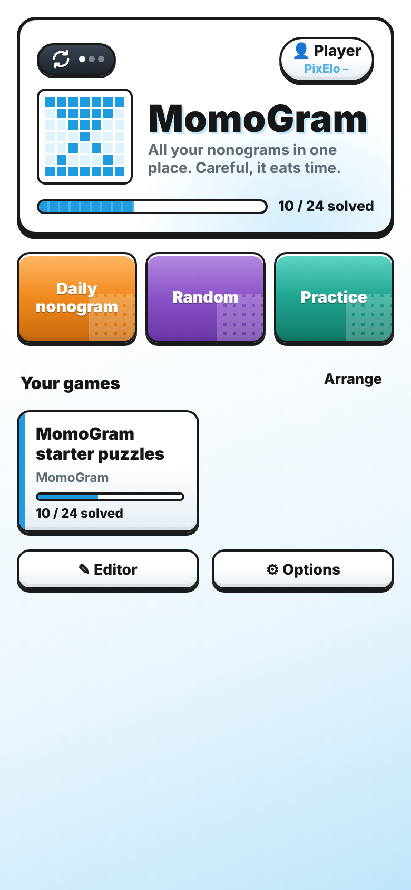
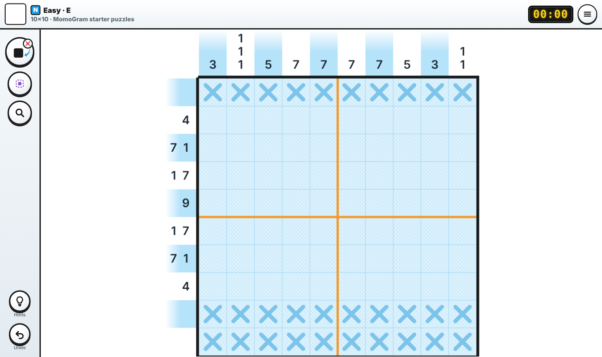

<p align="center"></p>

<h1 align="center">MomoGram</h1>

<p align="center"><b>One nonogram player for all the nonogram games you own</b>, on every screen: your phone (in portrait!),
the browser, Windows, macOS, Linux, Steam Deck and Android.<br>
Add your games once: MomoGram turns each into a pack with its levels, puzzle names, pictures, music and colours.</p>

<p align="center">
<a href="https://emil007.github.io/MomoGram/"><b>▶ Play in the browser</b></a> ·
<a href="https://github.com/Emil007/MomoGram/releases/latest"><b>⬇ Downloads</b></a> ·
<a href="#supported-games">Supported games</a> ·
<a href="#platforms">Platforms</a>
</p>

<p align="center">
<a href="https://github.com/Emil007/MomoGram/releases/latest"></a>
<a href="https://github.com/Emil007/MomoGram/actions/workflows/release.yml"></a>


</p>

| Your library | Pick a puzzle | Play, one-handed | Solved |
|---|---|---|---|
|  |  |  |  |

<p align="center"><br>
<em>Desktop / Steam Deck: keyboard, mouse and gamepad. The screenshots show MomoGram's own starter puzzles.</em></p>

> **No game data is included.** Start with MomoGram's own starter puzzles, then add the games you own:
> MomoGram reads the puzzles, names, pictures and music from your files. Everything stays on your device
> (or on your own server, if you set one up).

> **Disclaimer: 100% AI.** MomoGram (the game, the ROM readers, the importers, the sound code, the server,
> the builds and this documentation) was written entirely by an AI (Claude, by Anthropic), directed and tested
> by a human. No line of code was written by hand. Expect AI-typical mistakes, and please report what you find.

The name: *nonogram* + **Momo**, from Michael Ende's novel about the grey men who steal people's time.
Nonograms do that too.

## What you get

- **All your nonogram games in one library.** Each game you add becomes a card with its own modes and levels, puzzle names (shown once a puzzle is solved), solved pictures, music and colours. Games of a series form a folder (all Picross e games, Picross NP, Illust Logic, …); sort them by series or system, rearrange and hide them.
- **Mega mode:** one switch on the home screen turns the whole game into *Mega MomoGram*. Mega numbers span two rows or columns and count a connected group of cells that reaches into both. PICROSS e6–e9 and the Switch games bring their own Mega puzzles (PICROSS S+ adds them for every e game, and the Mega-only puzzles come along); for every other game MomoGram chooses the pairs itself, checks that each puzzle still has exactly one solution, and makes the same choice on every device, so times and medals stay comparable. Mega puzzles keep their own progress and scores.
- **Points and PixElo**, apart for normal and Mega puzzles (two games, each with its own progress, medals and high scores):
  - *Points* only go up: every puzzle is worth its best result once, by size and difficulty (measured by the solver), times the medal (platinum 4×, gold 3×, silver 2×, bronze 1×), plus up to 50 % for speed against the puzzle's par time. A better result later pays the difference. Puzzles solved before points existed are counted from their medals and times.
  - *PixElo* is a chess-style rating with each puzzle as the opponent: the puzzle's rating and par time come from the solver and its size. The first solve of a puzzle under each rule set is rated; Easy counts your time ×1.5, logic hints ×1.2, each roulette spin +30 s. Replays are unrated, and leaving a puzzle costs nothing. Everyone starts at 1000; ratings are provisional until 15 rated solves. The formulas and constants are in `src/game/rating.ts`.
- **A daily nonogram:** 15 puzzles a day, five per difficulty, drawn from all your games. Solving one counts in its own game too. And a **Random** button for one puzzle from anywhere.
- **Every puzzle on every difficulty**, with medals:

  | | Mistakes | Hint roulette | Medal |
  |---|---|---|---|
  | **Easy** | caught, no time penalty | offered | 🥉 Bronze |
  | **Normal** | caught, +2 / 4 / 8 minutes | offered | 🥈 Silver |
  | **Hard** | not checked, *Try it out* to test ideas | none | 🥇 Gold, 💠 **Platinum** without logic hints |

- **A board that feels like the handhelds:** striped clue bands, guide lines every five cells, a cursor that lights up its row and column into the clues, a drag counter, and clue numbers that grey out only when their block is certainly in place.
- **Three tools:** fill, cross out, and your own **marks**, which stay while you fill and cross the rest. One big button switches between fill and cross; *Tools on the right* puts it under your right thumb.
- **Logic hints** (💡): clue numbers turn blue when their line lets you deduce a new cell, like in the newer 3DS and Switch games. And the **hint roulette**, spinning over rows and columns like the original.
- **Made for one hand on a phone:** portrait layout, the tools at the bottom, pinch to zoom, drags that stay on their row or column. Landscape puts the tools beside the board.
- **Your progress is never lost:** every puzzle you start is kept and continues where you left it, best times per difficulty, medals, profiles with their own saves.
- **The games' own music:** every song of each game, a sound test to retag or switch songs off, a music bar at the bottom of the home screen shows what plays and skips to the next song; the same song from several games counts once.
- **An editor** for your own puzzles and packs.
- **Your own server (optional):** sync progress, settings and paused puzzles between your devices, share packs within your family or friends, and see each other's high scores (puzzles solved, medals, fastest times).
- Offline after the first start; English and German, with the games' puzzle names in every language they have.

## Supported games

**Puzzle packs → Add games or packs**: choose game files you own (raw, or in `.zip` / `.7z` / `.rar`).
MomoGram finds the puzzles and makes one pack per game, with the original level structure and the puzzle
names where the game has them. Regional versions of the same game become **one** pack with every
language's names. **Add a folder (everything in it)** takes a whole folder with its subfolders: every ROM,
archive, `.momopack` and Switch RomFS folder in it is read and stored one game at a time. The same song in
several games is kept only once on the device. Do it once: export the packs, or keep them on your server, and use them on every device.

| Game | Platform | Puzzles | Music & colours |
|---|---|---|---|
| Picross DS (full game and the Download Station / Nintendo Channel demos) | DS | ✓ all modes and levels, solved-picture animations, daily puzzles | ✓ the game's own (title, nine in-game styles, clear jingle) |
| Picross e, e2–e9, Pokémon Picross, Club Nintendo Picross (+ Plus), My Nintendo Picross, Sanrio Characters Picross | 3DS (decrypted) | ✓ | ✓ the game's music, colours from its icon |
| Mario's Picross | Game Boy | ✓ Easy, Kinoko, Star, Time Trial | ✓ the game's music (emulated), Super Game Boy colours |
| Picross 2 | Game Boy | ✓ as 15×15 sections | ✓ the game's music (emulated), Super Game Boy colours |
| Pokémon Picross (prototype) | Game Boy Color | ✓ all 217 stages (main game incl. Mew, Safari Zone); 20×20 and 30×30 pictures as their four sections | ✓ the game's music (emulated); colours in progress |
| Mario no Super Picross (also the Virtual Console release) | Super Famicom | ✓ all 300 puzzles | ✓ the game's music (emulated) |
| Tamori no Picross | Satellaview (.bs) | ✓ standard, daily and weekly puzzles; broadcasts are merged into one pack | ✓ the game's music (emulated) |
| Picross NP Vol. 1–8 | Super Famicom (Nintendo Power) | ✓ all puzzles of each volume, in sets of twelve (tested with Vol. 1: 120 puzzles) | ✓ the game's own music (emulated) |
| Illust Logic: Puzzle Series Vol. 6, Illust Logic DS + Colorful Logic, Illust Logic and Illust Logic + Nihon no Mukashi Banashi (DSiWare) | DS / DSiWare (Hudson) | ✓ 300 / 300 / 200 / 200 puzzles with coloured solved pictures; Vol. 6 with the answers' names (colour puzzles: later) | ✓ the game's music |
| DS Puzzler: Nanpure Fan & Oekaki Logic, Challenge Me: Brain Puzzles, DS Puzzler Wi-Fi Taiou | DS (Success) | ✓ 500 picture logic puzzles each, in ten levels, with names (Challenge Me: five languages) | ✓ the game's music |
| Illu-Logi VOW | DS (Success) | ✓ the 139 normal puzzles (colour puzzles: later) | ✓ the game's music |
| Hello Kitty no Paku Paku & Logic | DS | ✓ all 122 logic puzzles | ✓ the game's music |
| PICROSS S, S2–S9, S GENESIS & Master System, S Doraemon & F Characters, Lord of the Nazarick, LogiartGrimoire, Kemono Friends Picross, Raden's Guide for Pixel Museum | Switch (decrypted RomFS folder, or a zip of it) | ✓ the normal puzzles (150–281 per game), names in up to seven languages (Mega Picross reuses the same pictures; clip and colour puzzles: later) | ✓ the game's music (FMOD Vorbis, rebuilt as Ogg) |
| PICROSS S+ | Switch | ✓ all of Picross e – e9, merged with the 3DS packs of the same games (your progress stays), and its own 30 puzzles | ✓ the Switch versions of the e-series music |

Other nonogram games are added one by one (see the table). To add a game, see [docs/writing-importers.md](docs/writing-importers.md); each file in `src/packs/importers/` lists the games it reads and where their data is.

### Sound emulation (Game Boy, Super Famicom, Satellaview)

The Game Boy and Super Famicom games have no recorded music, only a sound program, so MomoGram runs that
program on emulated hardware, in an AudioWorklet (`worklet.js`, off the main thread; a ScriptProcessor fallback
for old browsers). Everything is MomoGram's own code, written from the public hardware documentation (Pan Docs /
gbdev.io for the Game Boy, fullsnes and anomie's documents for the SPC700, S-DSP and 65C816). No boot ROMs and
no game data are included.

- **Game Boy / Game Boy Color** (`src/audio/gb/`): Sharp LR35902 CPU with MBC1/3/5 banking, timer, interrupts
  and LCD timing; the APU with both pulse channels (sweep), wave, noise, frame sequencer and the output
  high-pass filter. Jupiter's games use Toshiyuki Ueno's "DSEQ" sound driver; MomoGram finds its two wrapper
  routines by byte pattern and calls them like a GBS player (start song, then the update routine at 59.7 Hz).
  A pack keeps only bank 0 and the driver banks of your ROM (32–48 KB).
- **Super Famicom / Satellaview** (`src/audio/snes/`): SPC700 with timers and I/O, the S-DSP (BRR decoding,
  4-point interpolation, ADSR / GAIN, noise, pitch modulation, 8-tap FIR echo, 32 kHz) and, for pack creation
  only, a 65C816 with the parts of the console a game touches while starting. The boot-ROM upload protocol is
  emulated instead of included. When you create a pack, your ROM boots until the game has loaded its sound
  driver, then the game's own play-song routine is called for every song of the game, and a compressed snapshot
  of the sound system (about 1 MB) is stored with the pack. Playback runs the SPC700 / S-DSP from there.

All songs a game has are stored with its pack and listed in the sound test (Options); the column on the right is
where MomoGram plays them by default. You can change that per song in the sound test, or switch songs off.

| Game | Songs | Played by default for |
|---|---|---|
| Mario's Picross | 19 (1–$13) | title, menu, two puzzle tracks, clear jingle |
| Picross 2 | 28 (1–$1C) | title, menu, two puzzle tracks, clear jingle |
| Pokémon Picross (prototype) | 36 ($01–$19, $81–$8B) | title, menu, puzzle, clear jingle |
| Mario no Super Picross | 24 ($00–$19, bit 6 = looping) | title, menu, puzzle, clear jingle |
| Picross NP Vol. 1–8 | 17–24 (same engine; silent numbers left out) | title, menu, two puzzle tracks, clear jingle |
| Tamori no Picross | 17 (same engine) | title, menu, two puzzle tracks, clear jingle |

Which song plays where was found by tracing the songs each game requests on its own screens (and its puzzle
music table); clear jingles were picked by their length where the game could not be traced to that screen.
Audio was checked numerically only (level, silence, loop and end detection). Known gaps: the combined Satellaview dump
"Tamori no Picross (8-13) + Bakushow …" has its sound library in an unexpected place and gets no music; the
S-DSP is sample-accurate rather than cycle-accurate and its interpolation kernel is computed, not the console's
table, so it sounds very close but not bit-identical.

### Why puzzles can be recognised by their picture

MomoGram matches puzzles by their pattern: to merge the regional versions of a game, to give a daily puzzle the
same id on every device, and to count a daily solve in its game. That is safe, because two different pictures
practically never have the same pattern:

| Grid | Possible patterns | About |
|---|---|---|
| 5 × 5 | 2<sup>25</sup> | 33,554,432 (33.6 million) |
| 10 × 10 | 2<sup>100</sup> | 1.27 × 10<sup>30</sup> (1.27 nonillion) |
| 15 × 15 | 2<sup>225</sup> | 5.39 × 10<sup>67</sup> (53.9 unvigintillion) |
| 20 × 20 | 2<sup>400</sup> | 2.58 × 10<sup>120</sup> |

Every cell is filled or empty, so a grid of *n* cells has 2<sup>*n*</sup> patterns. Only a part of them are good
puzzles (one solution, a recognisable picture), but even that part is far too large for two games to hit the same
pattern by chance. The same pattern in two games is the same puzzle, which happens when a game reuses puzzles of
an earlier one (Picross S+ and the 3DS Picross e games, for example).

## Platforms

Every push that changes the version builds a release on GitHub, for all of these:

| Platform | Download | Notes |
|---|---|---|
| **Browser** | [emil007.github.io/MomoGram](https://emil007.github.io/MomoGram/) | Chrome, Edge, Firefox, Safari. Install it as an app (*Add to Home Screen*), works offline. |
| **Android** | `MomoGram-<version>-Android.apk` | Allow installing from your browser / file manager, then open the APK. |
| **iPhone / iPad** | the browser version | Share → *Add to Home Screen* gives a full-screen app. |
| **Windows** | `MomoGram-<version>-Windows-x64-Setup.exe` or the `.zip` (x64 / arm64) | Unsigned: on the SmartScreen warning choose *More info → Run anyway*. |
| **macOS** | `MomoGram-<version>-macOS-arm64.dmg` (Apple Silicon) or `-x64.dmg` (Intel) | Not notarized: the first time, right-click the app → **Open**, or run `xattr -cr /Applications/MomoGram.app`. |
| **Linux** | `MomoGram-<version>-Linux-x86_64.AppImage` or `.tar.gz` (x64 / arm64) | `chmod +x` the AppImage. ARM64 runs on Raspberry Pi and ARM handhelds. |
| **Steam Deck** | the Linux AppImage | Add it to Steam as a non-Steam game; it starts fullscreen in Gaming Mode. |
| **RecompLauncher** | every release carries a `recomplauncher.json` | [RecompLauncher](https://github.com/elripalda/RecompLauncher) installs, updates and starts MomoGram. |

The desktop app takes `--rom <file.nds>` (or a ROM dropped on the program) to load a ROM at start, and
`--fullscreen`.

## Pack files

A pack is a single `.momopack` file: a zip with `pack.json` (the puzzles, plus a hidden version) and `assets/` (music, pictures, the game's icon). Double-clicking one opens it in the desktop app, or in the installed web version where the browser supports it. The format is described in [docs/momopack-format.md](docs/momopack-format.md).

## Your own server

If you want to, you can run a small server on your own web space (PHP with MySQL, e.g. Plesk). It keeps progress, the paused puzzle and settings in sync between your devices. It also keeps packs for everyone with an account there and shows high scores (puzzles solved, medals, fastest times). Accounts need an invite code that you choose. Download `MomoGram-…-server.zip` from the releases and follow [server/README.md](server/README.md).

## Controls

| | Touch / mouse | Keyboard | Gamepad / Steam Deck |
|---|---|---|---|
| Fill | tap / drag (stays on its row or column) | `Z` / Space, hold and move to paint | A |
| Cross out | ✕ tool, or right click | `X` | B |
| Move | | arrows / WASD | D-pad |
| Zoom | pinch, wheel, 🔍 | `C` | Y |
| Mark | ⬚ (third tool) | | |
| Undo | ↶ | `U`, Ctrl+Z | L |
| Try it out (Hard) | ✎ | | R |
| Menu | ☰ | Esc | Start |

## Building

```sh
npm ci
npm run build                 # web app in dist/web: static files for any web host
cp -r dist/web electron/web
cd electron && npm install && npx electron-builder --publish never   # desktop builds in dist/desktop
```

The GitHub Actions in `.github/workflows` do the rest: `ci.yml` (typecheck and build), `pages.yml`
(web version on GitHub Pages) and `release.yml` (web, Windows, macOS, Linux x64/arm64 and the Android
APK via Capacitor, released when `version` in `package.json` changes).

<details>
<summary><b>How it works</b></summary>

- `src/rom/nds.ts`: DS ROM file system, ARM9 / overlays, BLZ decompression.
- `src/rom/picrossds.ts`: puzzle-set tables, records, display order, localized names and solved-picture animation scripts.
- `src/rom/dsgfx.ts`: DS OBJ cells (4bpp, 2D mapping) for the solved pictures.
- `src/rom/ctr.ts`: decrypted 3DS containers (NCSD / NCCH / CIA), RomFS, icon, LZ11.
- `src/rom/unity.ts`, `lzma.ts`: Unity asset bundles and serialized files (Switch games); `src/audio/fsb5.ts`: FMOD sound banks, Vorbis rebuilt as Ogg.
- `src/audio/`: SDAT reader and SSEQ sequencer (DS music), BCSTM DSP-ADPCM decoder (3DS music); `gb/` and `snes/`: sound hardware emulation (see *Sound emulation*), `worklet.ts` / `chipplayer.ts`: playback on the audio thread.
- `src/packs/`: pack format, `.momopack` files, pack colours; `src/packs/importers/`: one file per import method, each starting with a table of the games it reads ([how to add one](docs/writing-importers.md)).
- `server/`: the optional sync / high score / pack server (PHP, MySQL or SQLite).
- `src/game/`: rules, exact line analysis (clue greying and logic hints), the board renderer.
- `src/app.ts`, `src/ui/`: screens.
</details>

## License

MIT for MomoGram's own code and its starter puzzles. Picross is a trademark of Nintendo; the game titles
named in the table of supported games are trademarks of their owners (Nintendo, Jupiter, Hudson, Success and others). MomoGram is an
unofficial fan project, not affiliated with or endorsed by them.
