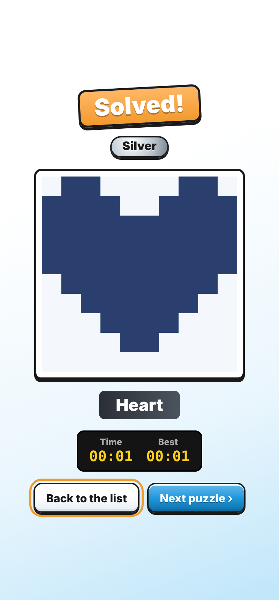

<p align="center"></p>

<h1 align="center">MomoGram</h1>

<p align="center"><b>One nonogram player for all the nonogram games you own</b>, on every screen: your phone (in portrait!),
the browser, Windows, macOS, Linux, Steam Deck and Android.<br>
Add your games once: MomoGram turns each into a pack with its levels, puzzle names, pictures, music and colours.</p>

<p align="center">
<a href="https://emil007.github.io/MomoGram/"><b>▶ Play in the browser</b></a> ·
<a href="https://github.com/Emil007/MomoGram/releases/latest"><b>⬇ Downloads</b></a> ·
<a href="#supported-games">Supported games</a> ·
<a href="#platforms">Platforms</a>
</p>

<p align="center">
<a href="https://github.com/Emil007/MomoGram/releases/latest"></a>
<a href="https://github.com/Emil007/MomoGram/actions/workflows/release.yml"></a>


</p>

| Your library | Pick a puzzle | Play, one-handed | Solved |
|---|---|---|---|
|  |  |  |  |

<p align="center"><br>
<em>Desktop / Steam Deck: keyboard, mouse and gamepad. The screenshots show MomoGram's own starter puzzles.</em></p>

> **No game data is included.** Start with MomoGram's own starter puzzles, then add the games you own:
> MomoGram reads the puzzles, names, pictures and music from your files. Everything stays on your device
> (or on your own server, if you set one up).

> **Disclaimer: 100% AI.** MomoGram (the game, the ROM readers, the importers, the sound code, the server,
> the builds and this documentation) was written entirely by an AI (Claude, by Anthropic), directed and tested
> by a human. No line of code was written by hand. Expect AI-typical mistakes, and please report what you find.

The name: *nonogram* + **Momo**, from Michael Ende's novel about the grey men who steal people's time.
Nonograms do that too.

## What you get

- **All your nonogram games in one library**, each with its own modes and levels, the puzzle names, solved pictures, music and colours of the original. Series form folders (all Picross e games, the S series, Picross NP, Illust Logic …); show them as cards, tiles or a list, sorted by series or system.
- **Every puzzle on every difficulty**, with medals:

  | | Mistakes | Hint roulette | Medal |
  |---|---|---|---|
  | **Easy** | caught, no time penalty | offered | 🥉 Bronze |
  | **Normal** | caught, +2 / 4 / 8 minutes | offered | 🥈 Silver |
  | **Hard** | not checked, *Try it out* to test ideas | none | 🥇 Gold, 💠 **Platinum** without logic hints |

- **Three ways to play:** the mode switch on the home screen cycles through *MomoGram*, *Mega MomoGram* and *Color MomoGram*. Each mode has its own progress, medals and high scores.
- **Mega mode** for everything: Mega numbers span two rows or columns. Games that have Mega puzzles bring their own (a glowing dot marks them); for all others MomoGram chooses the pairs, checks that each puzzle still has one solution, and makes the same choice on every device. Mega has its own progress and scores.
- **Colour mode:** colour nonograms, where every block has a colour and blocks of different colours may touch. The games' own colour puzzles (see below), MomoGram's own colour starter puzzles, and colour versions of the games' colour pictures where they work (few, clearly different colours and exactly one solution, checked by MomoGram's colour solver). A palette with the tools shows how many cells of each colour are still missing.
- **Points and PixElo** – points count everything you've solved, PixElo is a chess-style rating of how good you are ([how they work](#points-and-pixelo)). Your PixElo is shown under your name.
- **A board that feels like the handhelds:** the row and column you draw in light up into the clues, a counter shows the length of the block you're drawing, clue numbers grey out only when their block is certainly done, logic hints (💡) turn a clue blue when its line gives away a new cell, and your own marks stay while you fill and cross the rest.
- **Made for one hand on a phone:** portrait layout, tools at the bottom (or right), stepless pinch zoom, drags that stay on their line. Keyboard, mouse and gamepad on the desktop and Steam Deck.
- **A daily nonogram** (15 a day from all your games) and a **Random** button.
- **The games' own music**, every song of every game, with a sound test to choose where each plays.
- **Interactive tutorials** for nonograms, Mega and Colour (each offered once, all in the options), an **editor** for your own puzzles, light and **dark mode**, and six languages (English, German, French, Spanish, Italian, Japanese) – the puzzle names come in every language the games have. [Adding a language](#translations) is one file.
- **Your progress is never lost:** paused puzzles, best times per difficulty, medals, profiles with their own saves.
- **Your own server (optional):** progress and settings on all your devices, packs shared within your family or friends, and high scores for up to 10 players.

## Supported games

**Options → Puzzle packs → Add games or packs** reads game files you own (raw, or in `.zip` / `.7z` / `.rar`), or a whole folder with everything in it. MomoGram makes one pack per game, with the original level structure; regional versions of a game become **one** pack with every language's names, and the same song in several games is stored only once. Do it once: export the packs, or keep them on your own server, and use them on every device.

The numbers below are what MomoGram reads from the games (all regions together where there are several):

### Nintendo DS and DSiWare

| Game | Puzzles | Mega from the game | Puzzle names | Colour pictures | Songs | Notes |
|---|---:|---:|---|:---:|---:|---|
| Picross DS | 351 | – | ✓ 7 languages | – | 27 | solved-picture animations, daily puzzles |
| Picross DS demos (Download Station, Nintendo Channel) | 15 | – | ✓ JA | – | – |  |
| Puzzle Series Vol. 6: Illust Logic | 300 | – | ✓ JA | ✓ | 11 |  |
| Illust Logic DS + Colorful Logic | 300 | – | – | ✓ | 23 | colour puzzles: later |
| Illust Logic (DSiWare) | 200 | – | – | ✓ | 23 |  |
| Illust Logic + Nihon no Mukashi Banashi (DSiWare) | 200 | – | – | ✓ | 23 |  |
| DS Puzzler: Nanpure Fan & Oekaki Logic / Challenge Me: Brain Puzzles | 500 | – | ✓ 6 languages | – | 3 |  |
| DS Puzzler Wi-Fi Taiou | 500 | – | ✓ JA | – | 4 |  |
| Illu-Logi VOW | 139 | – | – | – | 40 | colour puzzles: later |
| Hello Kitty no Paku Paku & Logic | 122 | – | – | – | 4 |  |
| SIMPLE DS Vol. 7: THE Illust Puzzle | 1,401 | – | ✓ JA | ✓ | 9 | colour pictures, played as nonograms |
| SIMPLE DS Vol. 28: THE Illust Puzzle 2 | 1,400 | – | ✓ JA | ✓ | 8 | colour pictures, played as nonograms |
| Puzzle Mate DS: Oekaki Mate | 443 | – | ✓ JA | – | 4 | up to 45×50; 11 colour puzzles: later |
| Puzzle Iro Iro Vol. 1 (DSiWare) | 3 | – | – | – | 6 |  |
| Puzzle Iro Iro Vol. 2 (DSiWare) | 3 | – | – | – | 6 |  |
| Puzzle Iro Iro Vol. 3 (DSiWare) | 3 | – | – | – | 6 |  |
| Puzzle Iro Iro Vol. 4 (DSiWare) | 3 | – | – | – | 6 |  |
| Puzzle Iro Iro Vol. 5 (DSiWare) | 3 | – | – | – | 6 |  |
| Puzzle Iro Iro Vol. 6 (DSiWare) | 3 | – | – | – | 6 |  |
| **Total** | **5,889** | **0** | | | **215** | |

### Nintendo 3DS (decrypted)

| Game | Puzzles | Mega from the game | Puzzle names | Colour pictures | Songs | Notes |
|---|---:|---:|---|:---:|---:|---|
| Picross e | 150 | 150 (with PICROSS S+) | ✓ 7 languages | – | 5 |  |
| Picross e2 | 150 | 150 (with PICROSS S+) | ✓ 7 languages | – | 7 |  |
| Picross e3 | 150 | 150 (30 Mega-only) (all with S+) | ✓ 7 languages | – | 4 |  |
| Picross e4 | 150 | 150 (63 Mega-only) (all with S+) | ✓ 7 languages | – | 4 |  |
| Picross e5 | 150 | 150 (48 Mega-only) (all with S+) | ✓ 7 languages | – | 4 |  |
| Picross e6 | 152 | 152 (15 Mega-only) (all with S+) | ✓ 7 languages | – | 5 |  |
| Picross e7 | 150 | 165 (15 Mega-only) (all with S+) | ✓ 7 languages | – | 5 |  |
| Picross e8 | 150 | 165 (15 Mega-only) (all with S+) | ✓ 7 languages | – | 5 |  |
| Picross e9 | 150 | 165 (15 Mega-only) (all with S+) | ✓ 7 languages | – | 5 |  |
| Pokémon Picross | 311 | 313 (3 Mega-only) | ✓ JA | – | 22 |  |
| Club Nintendo Picross | 90 | – | ✓ JA | – | 4 |  |
| Club Nintendo Picross Plus | 105 | 48 (48 Mega-only) | ✓ JA | – | 5 |  |
| My Nintendo Picross: Zelda TP | 50 | 45 (1 Mega-only) | ✓ JA | – | 8 |  |
| Sanrio Characters Picross | 154 | 153 (1 Mega-only) | ✓ EN, JA | – | 5 |  |
| **Total** | **2,062** | **1,956** | | | **88** | |

### Nintendo Switch (decrypted RomFS folder, or a zip of it)

| Game | Puzzles | Mega from the game | Puzzle names | Colour pictures | Songs | Notes |
|---|---:|---:|---|:---:|---:|---|
| PICROSS S | 150 | 150 | ✓ 6 languages | – | 8 |  |
| PICROSS S2 | 150 | 150 | ✓ 6 languages | – | 14 |  |
| PICROSS S3 | 150 | 150 | ✓ 6 languages | – | 16 |  |
| PICROSS S4 | 155 | 150 | ✓ 6 languages | – | 16 |  |
| PICROSS S5 | 155 | 150 | ✓ 6 languages | – | 17 |  |
| PICROSS S6 | 155 | 150 | ✓ 6 languages | – | 17 |  |
| PICROSS S7 | 155 | 150 | ✓ 6 languages | – | 17 |  |
| PICROSS S8 | 155 | 150 | ✓ 7 languages | – | 17 |  |
| PICROSS S+ (own puzzles; its e1–e9 go into the e packs) | 30 | 30 | ✓ 7 languages | – | 20 |  |
| PICROSS S GENESIS & Master System Edition | 150 | 150 | ✓ 6 languages | – | 16 |  |
| PICROSS S Doraemon & F Characters Edition | 155 | 150 | ✓ 7 languages | – | 16 |  |
| Kemono Friends Picross | 150 | 150 | ✓ 6 languages | – | 14 |  |
| Picross Lord of the Nazarick | 81 | 81 | ✓ 6 languages | – | 23 |  |
| Picross -LogiartGrimoire- | 281 | – | ✓ 7 languages | – | 14 |  |
| Picross Juufuutei Raden’s Guide for Pixel Museum | 150 | – | ✓ EN, JA | – | 12 |  |
| **Total** | **2,222** | **1,761** | | | **237** | |

### Game Boy, Super Famicom and Satellaview

| Game | Puzzles | Mega from the game | Puzzle names | Colour pictures | Songs | Notes |
|---|---:|---:|---|:---:|---:|---|
| Mario’s Picross | 268 | – | – | – | 19 | Super Game Boy colours |
| Picross 2 | 836 | – | – | – | 28 | as 15×15 sections; Super Game Boy colours |
| Pokémon Picross (GBC prototype) | 490 | – | – | – | 36 | 20×20 and 30×30 as sections |
| Mario no Super Picross | 304 | – | – | – | 24 |  |
| Picross NP Vol. 1 | 120 | – | – | – | 21 |  |
| Picross NP Vol. 2 | 120 | – | – | – | 21 |  |
| Picross NP Vol. 3 | 120 | – | – | – | 21 |  |
| Picross NP Vol. 4 | 120 | – | – | – | 21 |  |
| Picross NP Vol. 5 | 120 | – | – | – | 21 |  |
| Picross NP Vol. 6 | 240 | – | – | – | 21 |  |
| Picross NP Vol. 7 | 240 | – | – | – | 21 |  |
| Picross NP Vol. 8 | 240 | – | – | – | 21 |  |
| Tamori no Picross | 93 | – | – | – | 17 | broadcasts merged into one pack |
| **Total** | **3,311** | **0** | | | **292** | |

**All supported games together: 13,484 nonograms, 3,717 Mega puzzles with the games' own Mega numbers (Mega-only puzzles included), and 832 songs.** Every other puzzle can be played as Mega too, with Mega numbers chosen by MomoGram.

### Colour puzzles

| Game | Colour puzzles | Colours |
|---|---:|---|
| PICROSS S3 – S9, S GENESIS, S Doraemon (Color Picross) | 30 each | 3–4 |
| Picross Lord of the Nazarick (Color Picross) | 27 | 3–4 |
| Illust Logic DS + Colorful Logic (Colorful Logic) | 100 | 2–5 |
| Illu-Logi VOW (Colour Logic) | 166 | 2–5 |
| Puzzle Mate DS: Oekaki Mate | 8 of its 10 colour puzzles | 4–5 |
| SIMPLE DS Vol. 7 / Vol. 28: THE Illust Puzzle | 1,400 each (the games' own colour pictures) | 1–5 |
| MomoGram starter puzzles | 9 | 2–5 |
| Hudson's Illust Logic games (pictures) | colour versions by MomoGram where they have one solution (95 in Illust Logic DS) | up to 8 |

Still to come: Animal Color Cross (DSiWare; its puzzles are in a compressed archive of its own) and two of Puzzle Mate's colour puzzles.

To add another game, see [docs/writing-importers.md](docs/writing-importers.md); each file in `src/packs/importers/` lists the games it reads and where their data is.

### Music

Every song a game has is stored with its pack and listed in the sound test (Options), where you choose which songs play on the title, in the menus, while solving and on the clear screen, or switch songs off. How the music is played:

| Platform | Source | How MomoGram plays it |
|---|---|---|
| DS / DSiWare | the game's SDAT sound archive | MomoGram's own SSEQ sequencer with the game's instruments |
| 3DS | BCSTM streams | DSP-ADPCM decoded in the browser |
| Switch | FMOD sound banks (FSB5) | the Vorbis streams rebuilt as Ogg files |
| Game Boy / Game Boy Color | the game's sound program | emulated sound hardware (CPU and APU), only the sound banks are kept |
| Super Famicom / Satellaview | the game's sound program | emulated SPC700 and S-DSP, from a snapshot taken when the pack is made |

The Game Boy and Super Famicom games have no recorded music, only a sound program, so MomoGram runs that program on emulated hardware, in an AudioWorklet off the main thread. Everything is MomoGram's own code, written from the public hardware documentation (Pan Docs / gbdev.io, fullsnes and anomie's documents); no boot ROMs and no game data are included.

<details>
<summary>Details of the sound emulation</summary>

- **Game Boy / Game Boy Color** (`src/audio/gb/`): Sharp LR35902 CPU with MBC1/3/5 banking, timer, interrupts and LCD timing; the APU with both pulse channels (sweep), wave, noise, frame sequencer and the output high-pass filter. Jupiter's games use Toshiyuki Ueno's "DSEQ" sound driver; MomoGram finds its wrapper routines by byte pattern and calls them like a GBS player. A pack keeps only bank 0 and the driver banks of your ROM (32–48 KB).
- **Super Famicom / Satellaview** (`src/audio/snes/`): SPC700 with timers and I/O, the S-DSP (BRR decoding, 4-point interpolation, ADSR / GAIN, noise, pitch modulation, 8-tap FIR echo, 32 kHz) and, for pack creation only, a 65C816 with the parts of the console a game touches while starting. When you create a pack, your ROM boots until the game has loaded its sound driver, then the game's own play-song routine is called for every song, and a compressed snapshot of the sound system (about 1 MB) is stored with the pack.
- Which song plays where was found by tracing the songs each game requests on its own screens. The S-DSP is sample-accurate rather than cycle-accurate, so it sounds very close but not bit-identical.
</details>

### Why puzzles can be recognised by their picture

MomoGram matches puzzles by their pattern: to merge the regional versions of a game, to give a daily puzzle the
same id on every device, and to count a daily solve in its game. That is safe, because two different pictures
practically never have the same pattern:

| Grid | Possible patterns | About |
|---|---|---|
| 5 × 5 | 2<sup>25</sup> | 33,554,432 (33.6 million) |
| 10 × 10 | 2<sup>100</sup> | 1.27 × 10<sup>30</sup> (1.27 nonillion) |
| 15 × 15 | 2<sup>225</sup> | 5.39 × 10<sup>67</sup> (53.9 unvigintillion) |
| 20 × 20 | 2<sup>400</sup> | 2.58 × 10<sup>120</sup> |

Every cell is filled or empty, so a grid of *n* cells has 2<sup>*n*</sup> patterns. Only a part of them are good
puzzles (one solution, a recognisable picture), but even that part is far too large for two games to hit the same
pattern by chance. The same pattern in two games is the same puzzle, which happens when a game reuses puzzles of
an earlier one (Picross S+ and the 3DS Picross e games, for example).

## Points and PixElo

MomoGram keeps two numbers for every player, and keeps them **twice**: once for normal puzzles and once for Mega puzzles (Mega is a game of its own, with its own progress, medals and high scores). The home screen shows the PixElo of the mode you're in under your name; the high scores have a tab for each. Everything below is computed from your saved progress, so all your devices (and the server) arrive at the same numbers.

Both start from what the solver knows about a puzzle (`src/game/difficulty.ts`): its **work**, the number of cells times the square root of the passes the line-by-line solver needs (at least 25), and whether it can be solved line by line at all. From the work come the puzzle's **rating** and its **par time**, the same on every device:

| | Rating | Par time |
|---|---|---|
| Formula | 500 + 220 · ln(work / 25), +250 if not solvable line by line, +120 for Mega | 10 s + 0.35 s · work, ×1.25 for Mega |
| typical 5×5 | about 650 | about 30 s |
| typical 10×10 | about 950 | about 1:20 |
| typical 15×15 | about 1200 | about 3:40 |
| typical 25×20 | about 1340 | about 6:40 |

### Points: everything you've solved

Points only go up. Every puzzle is worth **its best result, once**:

- **Base:** 5 · (1 + ln(work / 25)), +5 if it can't be solved line by line. A 5×5 gives about 8, a 15×15 about 21.
- **× medal**, only the best one counts: 🥉 bronze ×1 (Easy), 🥈 silver ×2 (Normal), 🥇 gold ×3 (Hard), 💠 platinum ×4 (Hard without logic hints). Platinum is worth more than gold because it's harder.
- **+ speed bonus:** up to +50 % for a time under par (none at par or slower).
- **× 1.25** for Mega puzzles.

When you do better later (a better medal, a faster time), you get only the difference, so replaying a puzzle on every difficulty doesn't add up: a 15×15 gold at par gives about 63, a platinum in half the par time about 104, and the platinum replaces the gold instead of adding to it. Puzzles solved before points existed are counted from their stored medals and times.

### PixElo: how good you are

PixElo is a rating like in chess, where every puzzle is an opponent with its own rating. Everyone starts at **1000**; a 1000 player is about even with a typical 10×10.

1. **Which solves count:** the **first solve of a puzzle under each rule set** (Easy, Normal, Hard), so one puzzle can be rated up to three times. Replays are unrated (the solved screen says so), and leaving a puzzle costs nothing, since puzzles are always kept and can be continued.
2. **Your score for a solve,** between 0 and 1, from your time against the par time: score = 1 / (1 + (time / par)^1.5). At par you score 0.5, in half the time about 0.74, in double the time about 0.26. Help makes the time count longer: Easy (mistakes are caught for you) ×1.5, logic hints ×1.2, each spin of the hint roulette +30 s.
3. **What was expected** of you against that puzzle: expected = 1 / (1 + 10^((puzzle − you) / 400)). Against a puzzle rated 200 above you, you're expected to score 0.24; 200 below you, 0.76.
4. **The change:** K · (score − expected), rounded. K is 40 for your first 15 rated solves (so you find your level fast) and 20 after that. Until then your PixElo is *provisional* (shown with a "?"). It never drops below 100.

Examples for a player at 1000: a 15×15 (rating ~1200) solved at par: +10; in half the par time: +20; in double the par time: +1. A 5×5 (rating ~650) at double par: −25, because a 1000 player should be much faster there.

The highest PixElo you've reached is kept as your peak. Your PixElo isn't stored but recalculated from your rated solves in the order you made them, so a device that syncs later gets the same value. All constants are in `src/game/rating.ts` (`RATING`).

## Platforms

Every push that changes the version builds a release on GitHub, for all of these:

| Platform | Download | Notes |
|---|---|---|
| **Browser** | [emil007.github.io/MomoGram](https://emil007.github.io/MomoGram/) | Chrome, Edge, Firefox, Safari. Install it as an app (*Add to Home Screen*), works offline. |
| **Android** | `MomoGram-<version>-Android.apk` | Allow installing from your browser / file manager, then open the APK. |
| **iPhone / iPad** | the browser version | Share → *Add to Home Screen* gives a full-screen app. |
| **Windows** | `MomoGram-<version>-Windows-x64-Setup.exe` or the `.zip` (x64 / arm64) | Unsigned: on the SmartScreen warning choose *More info → Run anyway*. |
| **macOS** | `MomoGram-<version>-macOS-arm64.dmg` (Apple Silicon) or `-x64.dmg` (Intel) | Not notarized: the first time, right-click the app → **Open**, or run `xattr -cr /Applications/MomoGram.app`. |
| **Linux** | `MomoGram-<version>-Linux-x86_64.AppImage` or `.tar.gz` (x64 / arm64) | `chmod +x` the AppImage. ARM64 runs on Raspberry Pi and ARM handhelds. |
| **Steam Deck** | the Linux AppImage | Add it to Steam as a non-Steam game; it starts fullscreen in Gaming Mode. |
| **RecompLauncher** | every release carries a `recomplauncher.json` | [RecompLauncher](https://github.com/elripalda/RecompLauncher) installs, updates and starts MomoGram. |

The desktop app takes `--rom <file.nds>` (or a ROM dropped on the program) to load a ROM at start, and
`--fullscreen`.

## Pack files

A pack is a single `.momopack` file: a zip with `pack.json` (the puzzles, plus a hidden version) and `assets/` (music, pictures, the game's icon). Double-clicking one opens it in the desktop app, or in the installed web version where the browser supports it. The format is described in [docs/momopack-format.md](docs/momopack-format.md).

## Your own server

If you want to, you can run a small server on your own web space (PHP with MySQL, e.g. Plesk). It keeps progress, the paused puzzle and settings in sync between your devices. It also keeps packs for everyone with an account there (each file stored once, music optional when downloading; a download that's interrupted, for example when the phone goes to sleep, continues where it stopped) and shows high scores (points, PixElo, puzzles solved, medals, fastest times). Up to 10 accounts. Accounts need an invite code that you choose. Download `MomoGram-…-server.zip` from the releases and follow [server/README.md](server/README.md).

## Controls

| | Touch / mouse | Keyboard | Gamepad / Steam Deck |
|---|---|---|---|
| Fill | tap / drag (stays on its row or column) | `Z` / Space, hold and move to paint | A |
| Cross out | ✕ tool, or right click | `X` | B |
| Move | | arrows / WASD | D-pad |
| Zoom / move | pinch (stepless), two fingers to move, wheel, 🔍 (hold and move to look around) | `C` | Y |
| Mark | ⬚ (third tool) | | |
| Undo | ↶ | `U`, Ctrl+Z | L |
| Try it out (Hard) | ✎ | | R |
| Menu | ☰ | Esc | Start |

## Building

```sh
npm ci
npm run build                 # web app in dist/web: static files for any web host
cp -r dist/web electron/web
cd electron && npm install && npx electron-builder --publish never   # desktop builds in dist/desktop
```

The GitHub Actions in `.github/workflows` do the rest: `ci.yml` (typecheck and build), `pages.yml`
(web version on GitHub Pages) and `release.yml` (web, Windows, macOS, Linux x64/arm64 and the Android
APK via Capacitor, released when `version` in `package.json` changes).

<details>
<summary><b>How it works</b></summary>

- `src/rom/nds.ts`: DS ROM file system, ARM9 / overlays, BLZ decompression.
- `src/rom/picrossds.ts`: puzzle-set tables, records, display order, localized names and solved-picture animation scripts.
- `src/rom/dsgfx.ts`: DS OBJ cells (4bpp, 2D mapping) for the solved pictures.
- `src/rom/ctr.ts`: decrypted 3DS containers (NCSD / NCCH / CIA), RomFS, icon, LZ11.
- `src/rom/unity.ts`, `lzma.ts`: Unity asset bundles and serialized files (Switch games); `src/audio/fsb5.ts`: FMOD sound banks, Vorbis rebuilt as Ogg.
- `src/audio/`: SDAT reader and SSEQ sequencer (DS music), BCSTM DSP-ADPCM decoder (3DS music); `gb/` and `snes/`: sound hardware emulation (see *Sound emulation*), `worklet.ts` / `chipplayer.ts`: playback on the audio thread.
- `src/packs/`: pack format, `.momopack` files, pack colours; `src/packs/importers/`: one file per import method, each starting with a table of the games it reads ([how to add one](docs/writing-importers.md)).
- `server/`: the optional sync / high score / pack server (PHP, MySQL or SQLite).
- `src/game/`: rules, exact line analysis (clue greying and logic hints), the board renderer.
- `src/app.ts`, `src/ui/`: screens.
</details>

## Translations

Every interface language is one file in [`src/i18n/`](src/i18n): `en.json`, `de.json`, `fr.json`, `es.json`, `it.json`, `ja.json`. To add a language, copy `en.json` to the new language's code (`nl.json`, …), translate the texts and set `_name` (the language's own name) and `_textOrder` (in which languages the games' own texts – puzzle names, level and game titles – are looked for, e.g. `nl,en,ja`). The build picks the file up; a text missing in a file falls back to English.

## License

MIT for MomoGram's own code and its starter puzzles. Picross is a trademark of Nintendo; the game titles
named in the table of supported games are trademarks of their owners (Nintendo, Jupiter, Hudson, Success and others). MomoGram is an
unofficial fan project, not affiliated with or endorsed by them.
